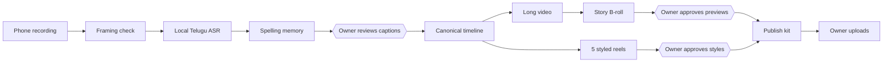

# An AI-assisted editing workflow for Telugu creators

**Author:** Chadalavada Bapiraju · creator of 360 LIFE (Telugu YouTube) · October 2026

One creator uses Claude Code for implementation and operation, Codex for independent review, and human approval
for editorial decisions. The first completed episode produced a 15-minute-26-second long video, five vertical reels,
17 story B-roll moments and an upload kit. This case study explains the architecture, measured results, failures and
remaining release work.

**Scope:** used to produce one complete episode. Repeatability across fresh recordings is not yet proven.

---

## 1. The problem

Our first episode required **252 owner-approved caption corrections**. Reliable Telugu captions, particularly
English loanwords, were a central challenge. Turning one recording into a long video and five styled reels by hand
is slow.

**The ambition:** AI handles the repetitive work, the creator decides everything that changes meaning or brand, and
nothing reaches the audience without that approval.

**Recorded baseline:** in the 18 October 2026 review session the creator reported 60 minutes to review episode 1's
long video and five reels (about 21 minutes of footage). Start and stop times and defect counts were not recorded.
No time savings are claimed.

## 2. System at a glance

| Role | Who | Boundaries |
|---|---|---|
| Builder | Claude Code leads implementation and operation | Project rules, reusable skills, persistent memory; never publishes; credentials stay outside source control and public artifacts |
| Reviewer | Codex independently reviews code and outputs and files numbered reports | Read-only review, with explicitly authorised exceptions: Codex made some narrow fixes and diagnostic renders during development |
| Approver | The creator owns every editorial, brand and publishing decision | Approvals are recorded |
| Tools | FFmpeg, Remotion, MediaPipe, offline Telugu ASR | Run through a bounded process runner |

## 3. Agentic patterns

### 3.1 Separate builder, reviewer and human approver roles
In review, Codex found that the reel mixer's limiter delayed speech by **239 samples (≈5 ms)**, using an impulse
test. Claude reproduced it and enabled latency compensation; in the same impulse test the sound then lands on the
exact sample. *Status: committed after independent review (22 Oct 2026).*

### 3.2 Skills as operating procedures
Each repeatable job is a short skill document (`skills/`) with house rules, exact commands and stop points:
captions and reel styles, story B-roll, publishing.

### 3.3 Approvals as data (intended contract)
Gates: plan → placement → exact asset → final render → playback. The intended contract: an approval names who, when
and what evidence, plus the SHA-256 of the exact previews or settings it approves, so a later change invalidates it.

*Status (22 Oct 2026):* implemented in the full workflow after three rounds of independent review. Story B-roll
finalisation checks the approval against the exact previews, base, timeline and selection. A reel approval covers one
render manifest: settings, render options, every consumed media file, bundle code and the measured renderer context
(mixing and mux code, FFmpeg executable). A final release needs an explicit final request **and** a matching approval;
every other render stays a labelled preview. 41 regression tests pass, and one owner-approved full-size final was
rendered while the same approval with one changed input was refused. Not yet pinned: browser version, fallback
fonts, model weights. This render-approval code is not part of the toolkit extraction.

### 3.4 Context that survives long sessions
One hand-off document (`CURRENT_STATE.md`), a memory of durable decisions, git tags for known-good states, and
background jobs with notifications.

### 3.5 Fail closed
Caption corrections that match zero or two words, or come from a different recording, stop the job; so do B-roll
labels containing English letters and preview clips whose fingerprint changed.

## 4. Problems and solutions

| # | Problem | Solution | Evidence |
|---|---|---|---|
| 01 | Telugu captions, especially loanwords | Source-bound corrections: one spoken word → one word at an exact time, approved by the creator; the raw ASR transcript is preserved and approved corrections produce a derivative | 252 owner-approved corrections. Script check on the corrected captions (correction set of 21 Oct 2026): the scanner found no Latin letters or the malformed Telugu sequences it checks in 2,183 words. Spelling and meaning were checked separately by the creator's review |
| 02 | Same spellings re-fixed every episode | Spelling memory proposes previously approved fixes; short or context-dependent words only "check" | 206 words learned. Same-recording experiment: 164 proposals (108 confident) — not evidence of accuracy on new footage |
| 03 | Corrections bound to edited times failed on raw ASR (~20 ms apart) | Re-bind by position and prove identical text before running | Caught before a 1.5-hour run |
| 04 | Keeping every output in sync | One canonical timeline in integer 30 fps frames | An independent re-run matched the approved cuts over 27,776 frames |
| 05 | Renderer dependence | The canonical timeline separates editorial timing from renderer-specific execution | A replacement renderer has not been demonstrated |
| 06 | Approvals that could be bypassed | Fingerprint-bound approval records | Review found gaps; fixed, reviewed, 41 regression tests and one owner-approved end-to-end test |
| 07 | B-roll felt like filler | One B-roll per story beat; each label appears on its spoken word | 17 approved moments; English letters in labels are rejected by the renderer |
| 08 | Old clips carried old captions | Build B-roll last, over the final captioned base | Found by inspecting a clip before use |
| 09 | Laptop sleep killed a 16-hour job | Keep-awake, bounded process trees, clean cancel marks a job INTERRUPTED | Two redundant runs cancelled with no orphaned processes |
| 10 | Rework from one-word changes | Batch every fix before a run; cancel superseded runs | Standing rule |
| 11 | Edited file was a processed copy | Audio cross-correlation maps the original recording piece by piece | Hidden cuts located at frames 1740, 1874, 1954 |
| 12 | Vertical phone video vs 16:9 YouTube | Framing check: borders, median face position, exact crop with preview pictures | Route chosen from pictures |
| 13 | Unsafe or misleading topics | Explain-only money topics, no party imagery, official health sources, AI disclosure | Written into the content plan |
| 14 | Licensing | Original project contributions use MIT; dependencies, models and upstream material keep their own terms | Remotion has a separate licence: https://www.remotion.dev/docs/license |

### What did not work
Illustrated backgrounds behind the presenter, and then real-photo background replacement with light matching, were
both rejected by the creator as not realistic: hair edges and light direction still read as composited. The code was
removed.

## 5. Remaining release work
- ~~Approval-gate fixes~~ done 22 Oct 2026 (reviewed; end-to-end test on one reel).
- Prove repeatability on a fresh recording, and complete final playback review.
- Resolve earlier installation and optional-ranker findings in the full workflow.
- Finish licence documentation and a separate review before the repository goes public.

## 6. Patterns any small AI team can reuse
1. Separate build, review and approval roles.
2. Turn every repeated task into a skill with commands and stop points.
3. Make approvals data, bound to file fingerprints, and test that binding.
4. Keep one hand-off document and one memory of durable decisions.
5. Fail closed at every validator.
6. Batch decisions before expensive runs; cancel superseded work cleanly.
7. Measure, then claim.

## 7. Related architecture topics
| Topic | Where it shows up |
|---|---|
| Orchestration | Builder, reviewer and approver roles; gated pipeline; background jobs |
| Claude Code | Project rules, skills, memory, frozen tags |
| Structured output | JSON specs as the agent's contract: moments, picks, thumbnails, correction overlays |
| Tools | Bounded process runner; fail-closed validators; browser and terminal tools for review pages |
| Reliability | Hand-off document, approval records, independent review, synthetic test data |

These are general agentic-architecture topics; they are not mapped to an official exam blueprint, and no
certification is claimed.

## 8. Open problems: build them with us
1. **Realistic, disclosed B-roll** from AI video generation, inside the approval gates.
2. **AI co-host podcast**: two speakers, Telugu and English in the same sentence; recorded first, live later.
3. **Better Telugu ASR**: loanword dictionaries and shared spelling memories across creators.
4. **A hosted service** for other creators: isolation, render cost control, licensing.
5. **Live captions** in Telugu with an AI co-host at stream latency.

Open an issue or discussion with the problem number you want to work on.
